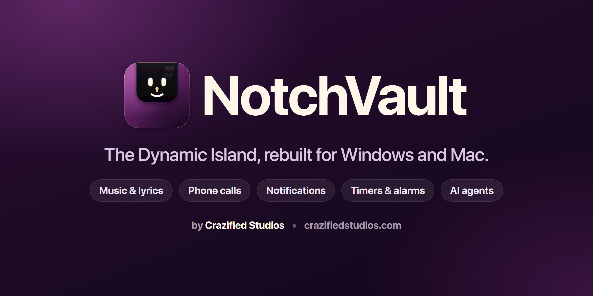

<div align="center">



<br><br>

**A Dynamic Island for your Windows PC.**<br>
Music, calls, notifications, timers and AI agents, in one small island at the top of your screen.

<br>

[](https://github.com/advik-srivastava/NotchVault/releases/latest)

<sub>Windows 10 and 11 · 64-bit · Free</sub>

</div>

<br>

## What it does

NotchVault sits at the top centre of your screen as a thin line. When something happens, it opens up to show it, then gets out of your way.

- **🎵 Music**: Apple Music, Spotify and other players, with synced lyrics and colours from the album art
- **📞 Calls**: incoming calls from your Android phone through Phone Link, with the caller's photo
- **🔔 Notifications**: WhatsApp, Instagram and other phone apps, plus Outlook, with contact photos
- **✳️ AI agents**: see when Claude, Codex, Copilot or ChatGPT is working, waiting for you or done
- **⏱️ Timers and alarms**: several timers at once, alarms and Focus sessions
- **📅 Calendar and to-do**: upcoming events, reminders and a quick task list
- **📋 Clipboard**: everything you copied, ready to paste again
- **🔋 System**: charging, Bluetooth devices, volume, brightness, Wi-Fi and airplane mode

## Install

1. Download **NotchVault-Setup-1.0.0.exe** from the [latest release](https://github.com/advik-srivastava/NotchVault/releases/latest).
2. Open it. If Windows says *"Windows protected your PC"*, click **More info**, then **Run anyway**.
3. Follow the short welcome. It explains every button.

For calls and phone notifications, connect your Android phone with **Phone Link** first.

## How to use it

- **Open the island**: move your pointer to the top of the screen, or press <kbd>Ctrl</kbd> + <kbd>Alt</kbd> + <kbd>T</kbd>.
- **Switch pages**: click the icons along the top of the island.
- **Settings**: click ⚙ in the island, or the NotchVault icon in the taskbar's hidden icons.

The three buttons in the corner work everywhere:

| | Button | What it does |
| :-: | :-: | :-- |
| 🔴 | × | Quits the music app |
| 🟡 | − / + | Hides the island to a thin line, or brings it back |
| 🟢 | ↗ | Keeps the island open |

## Privacy

Everything runs on your PC. Your notifications, calls and clipboard never leave it. NotchVault only goes online to fetch song lyrics and any calendars you add.

<details>
<summary><b>Connect AI agents in the terminal</b></summary>

<br>

The Claude, ChatGPT, Copilot, Cursor and Gemini apps work automatically. For **Claude Code**, add this to `~/.claude/settings.json`:

```json
"hooks": {
  "UserPromptSubmit": [{ "hooks": [{ "type": "command", "command": "curl -s -X POST \"http://127.0.0.1:47823/agent?agent=claude&state=working\"" }] }],
  "Notification":     [{ "hooks": [{ "type": "command", "command": "curl -s -X POST \"http://127.0.0.1:47823/agent?agent=claude&state=waiting\"" }] }],
  "Stop":             [{ "hooks": [{ "type": "command", "command": "curl -s -X POST \"http://127.0.0.1:47823/agent?agent=claude&state=done\"" }] }]
}
```

For **Codex CLI**, add this to `~/.codex/config.toml`:

```toml
notify = ["curl", "-s", "-X", "POST", "http://127.0.0.1:47823/agent?agent=codex&state=done"]
```
</details>

<details>
<summary><b>Build it yourself</b></summary>

<br>

You need Node.js 20+ and Python 3.12.

```bash
git clone https://github.com/advik-srivastava/NotchVault.git
cd NotchVault
npm install
pip install -r bridge/requirements.txt
npm start
```

To make the installer, run `npm run build:bridge` and then `npm run dist`.
</details>

<br>

<div align="center">

Made by **[Crazified Studios](https://crazifiedstudios.com)**

<sub>Not affiliated with Apple or Microsoft. Product names belong to their owners.</sub>

</div>
